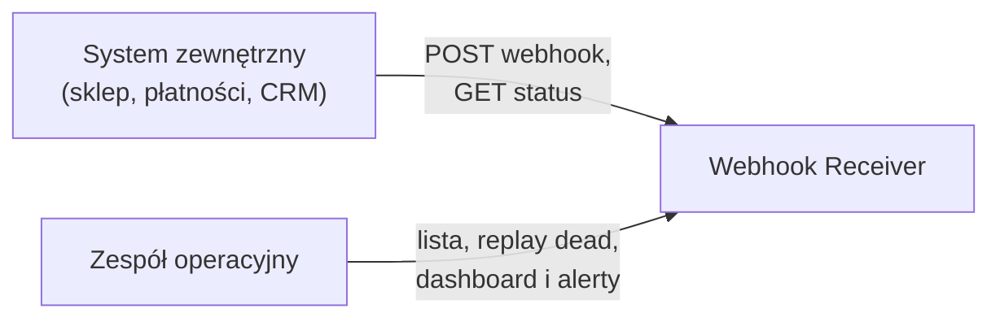
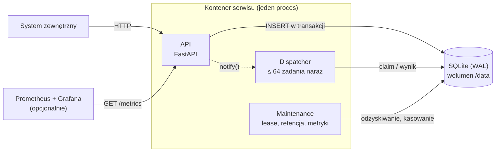

# Webhook Receiver

HTTP API, które przyjmuje webhooki JSON, zapisuje je trwale w SQLite przed
potwierdzeniem, przetwarza asynchronicznie i udostępnia status każdego
zdarzenia. Python 3.15, FastAPI, aiosqlite.

**Spis treści:** [Zakres](#zakres) · [Uruchomienie](#uruchomienie) ·
[API](#api) · [Architektura](#architektura) ·
[Jak spełnione są wymagania](#jak-spełnione-są-wymagania) ·
[Tradeoffs](#tradeoffs) · [Benchmark](#benchmark) ·
[Konfiguracja](#konfiguracja) · [Harness](#harness) · [TODO](#todo)

## Zakres

- **Rdzeń zadania:** zapis do SQLite przed odpowiedzią 202, idempotency po
  `idempotency_key`, asynchroniczny worker z leasingiem i odzyskiwaniem po
  restarcie, endpoint statusu, retencja. Kod: `app/api.py`,
  `app/repository.py`, `app/worker.py`, `app/maintenance.py`,
  `app/schema.sql`.
- **Punkty bonusowe z zadania:** testy, rate limiting, `/health`, `/ready`,
  `/metrics`, retry z backoffem i dead-letter, benchmark.
- **Dodatki poza zadaniem:** podpisy HMAC (domyślnie wyłączone), Grafana i
  alerty Prometheusa w `monitoring/`, skany bezpieczeństwa w CI. Rdzeń działa
  bez nich.

README jest jedynym opisem projektu; robocze specyfikacje i listy zadań nie
trafiły do repo, żeby nie rozjeżdżały się z kodem.

## Uruchomienie

```bash
docker compose up --build    # serwis na http://localhost:8000
```

Baza leży na wolumenie `webhook-data` i przetrwa restart kontenera. Obraz
instaluje dokładnie wersje z `uv.lock`.

Lokalnie (wymaga [uv](https://docs.astral.sh/uv/) i
[just](https://github.com/casey/just)):

```bash
just install    # zależności + hook pre-commit
just run        # serwis z bazą w ./data/webhooks.db
just check      # lint + 48 testów + bandit + pip-audit, to samo co CI
just e2e        # cały serwis w Dockerze: 15 sprawdzeń PASS/FAIL, łącznie z crashem
just bench      # 1000 webhooków/min przez 60 s (serwis musi działać)
```

```bash
curl -i -X POST localhost:8000/webhooks -H 'Content-Type: application/json' -d '{
  "idempotency_key": "evt-001",
  "event_type": "order.created",
  "payload": {"order_id": "ORD-2024-1234", "amount": 299.99, "currency": "PLN"}
}'
# 202 Accepted, Location: /webhooks/evt-001

curl localhost:8000/webhooks/evt-001   # po 2–5 s: "status": "completed"
# ten sam POST jeszcze raz: 200 z istniejącym statusem, bez przetwarzania
# ten sam klucz z innym payloadem: 409 payload_conflict
```

## API

| Metoda | Endpoint | Odpowiedzi |
|---|---|---|
| POST | `/webhooks` | 202 nowe, 200 duplikat, 409 konflikt, 401 zły podpis, 413 za duże, 422 niepoprawne, 429 limit, 503 kolejka pełna / baza niedostępna / shutdown |
| GET | `/webhooks/{key}` | 200 status, 401 zły podpis, 404 nieznany, 422 zły format klucza, 503 baza niedostępna |
| GET | `/webhooks?status=&limit=&after=` | lista dla operatora (`X-Admin-Token`): 200, 401, 422, 503 |
| POST | `/webhooks/{key}/replay` | `dead` → `pending` (`X-Admin-Token`): 202, 401, 404, 409 nie `dead`, 503 |
| GET | `/health` | 200, gdy proces odpowiada |
| GET | `/ready` | 200 gotowy, 503 baza / dispatcher niedostępne albo shutdown |
| GET | `/metrics` | 200, format Prometheusa |

Status zawiera `status`, `attempts`, czasy, `last_error` i `result`. Payload
nie wraca w statusie i nie trafia do logów (dane osobowe).

## Architektura

Opis na trzech poziomach modelu C4: kontekst, kontenery, komponenty. Poziomu
kodu celowo nie dokumentujemy, bo zestarzałby się po pierwszej zmianie.

### C1: kontekst



Systemy zewnętrzne wysyłają zdarzenia i pytają o ich status. Zespół
operacyjny widzi stan kolejki, dostaje alerty i ponawia zdarzenia `dead`.

### C2: kontenery



Jeden proces, bo SQLite ma jednego writera. API w jednej transakcji zapisuje
zdarzenie i klucz idempotencji, potem budzi dispatcher. Dispatcher jednym
`UPDATE ... RETURNING` bierze tyle zdarzeń, ile ma wolnych slotów, i każde
przetwarza w osobnym tasku asyncio. Baza jest jednocześnie kolejką, więc nie
ma osobnego brokera.

### C3: komponenty

| Moduł | Odpowiedzialność |
|---|---|
| `domain.py` | statusy, reguły retry i odzyskiwania, hash kanoniczny; bez I/O |
| `repository.py` | cały SQL; zapisuje decyzje domeny, sam ich nie podejmuje |
| `worker.py` | dispatcher: claim, przetwarzanie, zapis wyniku z fencingiem |
| `maintenance.py` | odzyskiwanie dzierżaw, retencja, metryki kolejki |
| `api.py`, `schemas.py` | HTTP i walidacja |
| `auth.py`, `ratelimit.py` | podpis HMAC, limit per źródło |
| `main.py` | składa wszystko razem |

Zależności wskazują do `domain.py`; test statyczny pilnuje, że domena nie
importuje FastAPI, aiosqlite ani asyncio. Przy zamianie SQLite na Postgresa
reguły domenowe zostają bez zmian; większość pracy to `repository.py`,
schemat i warstwa infrastruktury (zależności, konfiguracja, Compose, część
testów).

Flow biznesowy zdarzenia (statusy) jest w sekcji
[Model danych](#model-danych).

## Jak spełnione są wymagania

### Niezawodność

- **Odpowiedź po zapisie.** 202 wychodzi dopiero po `COMMIT`. Kolejka nie
  istnieje poza bazą, więc restart niczego nie gubi.
- **Lease z tokenem (fencing).** Claim ustawia `processing`, losowy
  `lease_token` i `locked_until = now + 30 s`. Wynik i błąd zapisują się tylko
  z aktualnym tokenem, więc wolny worker, któremu odebrano zdarzenie, nie
  nadpisze cudzego wyniku.
- **Crash.** Przy jednej instancji każdy wiersz `processing` po starcie jest
  osierocony i wraca do kolejki od razu, przed startem workerów. Sprawdzone
  `kill -9` na 20 zdarzeniach w trakcie przetwarzania: wszystkie `completed`.
- **SIGTERM.** Nowe zdarzenia nie są pobierane, bieżące dostają wspólny termin
  `SHUTDOWN_GRACE`, a niedokończone wracają z `attempts - 1`, więc wdrożenie
  nie zjada prób.
- **Retry i poison pill.** Błąd daje `retry_scheduled` z backoffem
  `2 s · 2^(n-1)` (max 300 s, jitter do 20 %), po 5 próbach `dead`. Utrata
  lease też liczy się jako próba, więc zdarzenie wywracające proces nie wraca
  w nieskończoność. Operator może zrobić `replay`.

### Idempotency

- `idempotency_key UNIQUE` i `INSERT ... ON CONFLICT DO NOTHING RETURNING *`:
  wyścig duplikatów rozstrzyga indeks w SQLite. Test: 50 równoległych POST z
  tym samym kluczem daje 1× 202, 49× 200 i jedno przetworzenie.
- Hash SHA-256 kanonicznego JSON-a odróżnia duplikat (200) od ponownego
  użycia klucza z inną treścią (409, bo cichy duplikat ukryłby błąd nadawcy).
- Klucze żyją w osobnej tabeli 90 dni, dłużej niż payload (7/30 dni). Nadawca
  może ponowić webhook po retencji payloadu, a klucz nadal nie uruchomi
  drugiego przetworzenia.

| Etap | Gwarancja |
|---|---|
| Utworzenie zadania | najwyżej raz dla danego `idempotency_key` w okresie życia klucza (90 dni); odpowiedź 202 może zginąć po `COMMIT`, wtedy ponowienie dostaje 200 |
| Wykonanie handlera | co najmniej raz: crash w trakcie oznacza ponowienie |
| Zapis wyniku | dokładnie raz (fencing) |
| Kolejność | brak: `order.paid` może wyprzedzić `order.created` |

Wykonania kodu dokładnie raz nie da się zagwarantować przy awarii procesu.
Efekty uboczne poza SQLite (np. e-mail) wymagałyby idempotencji po
`idempotency_key` u odbiorcy albo transakcyjnego outboxa.

### Przetwarzanie async

- Przyjęcie to jedna krótka transakcja (sprawdzenie klucza, limitu kolejki,
  zapis zdarzenia i klucza) i `notify()`; przetwarzanie dzieje się w
  dispatcherze, niezależnie od requestu.
- **Jeden claimer zamiast 64 pollujących workerów:** jedno zapytanie na
  wybudzenie i dokładny limit współbieżności.
- **Jedno połączenie zapisujące:** SQLite ma jednego writera, więc zapisy idą
  przez jedno połączenie i `database is locked` między naszymi zapisami nie
  występuje. Odczyty idą osobnym połączeniem (WAL).
- **Skala:** z prawa Little'a 1000/min × średnio 3,5 s ≈ 58 zdarzeń w toku,
  stąd 64 sloty. SQLite dostaje ~50 krótkich zapisów/s.

### Model danych

`webhook_events` jest jednocześnie skrzynką, kolejką i magazynem wyników;
`webhook_idempotency_keys` pamięta klucze. Schemat: `app/schema.sql`.

```
pending ──claim──► processing ──ok──► completed
   ▲                  │  │
   │  lease utracona  │  └─błąd──► retry_scheduled ──(next_attempt_at)──► claim
   └──────────────────┘                │
                                po MAX_ATTEMPTS ──► dead ──replay──► pending
```

| Indeks | Do czego |
|---|---|
| `(next_attempt_at) WHERE status IN ('pending','retry_scheduled')` | claim; częściowy, tylko praca do zrobienia |
| `(locked_until) WHERE status = 'processing'` | odzyskiwanie wygasłych dzierżaw |
| `(status, completed_at)` | liczenie kolejki i retencja |
| `UNIQUE (idempotency_key)` | idempotencja i GET statusu |

**Retencja** (co godzinę, partiami po 1000): `completed` 7 dni (dłużej niż
typowe okno retry nadawców), `dead` 30 dni (czas na analizę i replay), klucze
90 dni. Niezakończona praca nigdy nie jest kasowana.

### Obserwowalność

- **Główny sygnał:** `webhooks_dispatch_lag_seconds`, czyli jak długo
  najstarsze gotowe zdarzenie czeka na worker. Rośnie, zanim klient zauważy
  problem.
- **Metryki:** ruch per wynik (przyjęte, duplikaty, 401/429/503), wyniki
  przetwarzania, głębokość kolejki, czasy (przyjęcie, przetwarzanie, end to
  end), odzyskane i odrzucone dzierżawy, zajęte sloty, wolne miejsce na dysku.
- **Logi:** JSON, osobna linia na każdy etap życia zdarzenia
  (`webhook.received`, `webhook.claimed`, `webhook.completed`,
  `webhook.retry_scheduled`, `webhook.dead`, `lease.recovered`...). Każda
  linia dotycząca zdarzenia ma `idempotency_key`, więc `grep evt-001`
  pokazuje całą jego historię.
- **Health vs ready:** `/health` nie dotyka bazy, więc orkiestrator nie
  restartuje serwisu przy chwilowej blokadzie; `/ready` sprawdza bazę i
  dispatcher.
- `docker compose --profile monitoring up` stawia Prometheusa z 11 alertami i
  Grafanę z gotowym dashboardem: <http://localhost:3000/d/webhooks/webhook-receiver>.

### Bezpieczeństwo

- **HMAC-SHA256** (`WEBHOOK_SECRETS='shop:sekret'`): podpis
  `f"{timestamp}.{raw_body}"` sprawdzany na surowym body. Znacznik czasu
  starszy niż 300 s albo nieliczbowy (`nan`, `inf`) daje 401, a powtórzenie w
  oknie to zwykły duplikat.
- **Limity:** body ≤ 256 KB, zagnieżdżenie JSON ≤ 32, rate limit 50 req/s per
  źródło (429), `MAX_QUEUE_DEPTH` 10 000 (503). Limit kolejki jest liczony w
  tej samej transakcji co zapis, więc równoległe requesty go nie przekroczą.
- Awaria bazy w każdym endpoincie daje 503 z `Retry-After`, nigdy 500.
- SQL tylko z parametrami. `tests/test_security.py` ma 11 scenariuszy ataku,
  a CI uruchamia `bandit` i `pip-audit`.

## Tradeoffs

| Wybór | Zamiast | Dlaczego / koszt |
|---|---|---|
| SQLite jako kolejka | Redis, RabbitMQ, Celery | przyjęcie i zakolejkowanie atomowo, jedno źródło prawdy; koszt: jedna instancja |
| Worker w procesie API | osobny serwis | jeden kontener; cały SQL w `repository.py`, więc rozdzielenie jest tanie |
| Jeden claimer + N tasków | N pollujących workerów | brak thundering herd, dokładny limit współbieżności |
| Lease + fencing | heartbeat | wystarcza przy pracy ≤ 5 s i lease 30 s |
| Odzyskanie od razu przy starcie | czekanie na wygaśnięcie lease | restart nie opóźnia pracy; poprawne tylko dla jednej instancji |
| 409 przy innym payloadzie | cichy duplikat | ujawnia błąd nadawcy |
| 503 przy pełnej kolejce | zapis mimo wszystko | odrzucone nie jest przyjęte; duplikaty nadal dostają 200 |
| Rate limit w pamięci | Redis | wystarcza dla jednej instancji |
| Brak gwarancji kolejności | kolejność per encja | prostota; patrz TODO |

## Benchmark

`just bench`: requesty idą według stałego harmonogramu, niezależnie od
odpowiedzi, jak u prawdziwych nadawców. 1000 webhooków/min przez 60 s, 10 %
duplikatów, obraz Docker na Apple M5 Pro:

```
status codes: {200: 100, 202: 900}
ingest latency ms: p50=3.6 p95=5.0 p99=6.3
all terminal after 66.4s; unfinished=0
```

## Konfiguracja

Wszystkie zmienne środowiskowe, walidowane przy starcie (`app/config.py`):

| Zmienna | Domyślnie | |
|---|---|---|
| `DB_PATH` | `/data/webhooks.db` | plik bazy |
| `WORKER_CONCURRENCY` | 64 | sloty przetwarzania |
| `LEASE_SECONDS` | 30 | musi być ≥ 3 × `PROCESSING_MAX` |
| `POLL_INTERVAL` | 0,5 | s; najdłuższe czekanie dispatchera na pracę |
| `RECOVERY_INTERVAL`, `STATS_INTERVAL` | 10, 1 | s; odzyskiwanie dzierżaw, odświeżanie metryk kolejki |
| `MAX_ATTEMPTS`, `BACKOFF_BASE`, `BACKOFF_MAX` | 5, 2, 300 | retry |
| `MAX_QUEUE_DEPTH` | 10000 | backpressure |
| `MAX_BODY_BYTES` | 262144 | limit body (413) |
| `RATE_LIMIT_RPS`, `RATE_LIMIT_BURST` | 50, 100 | per źródło |
| `ALLOWED_SOURCES` | puste | znane źródła; reszta trafia do jednego kubełka `other` |
| `WEBHOOK_SECRETS`, `SIGNATURE_TOLERANCE` | puste, 300 | HMAC (`zrodlo:sekret,...`), okno znacznika czasu w s |
| `ADMIN_TOKEN` | puste | puste = endpointy admina zawsze 401 |
| `RETENTION_COMPLETED_DAYS`, `RETENTION_DEAD_DAYS`, `RETENTION_IDEMPOTENCY_DAYS` | 7, 30, 90 | retencja |
| `RETENTION_INTERVAL` | 3600 | s; jak często działa retencja |
| `PROCESSING_MIN`, `PROCESSING_MAX`, `FAILURE_RATE` | 2, 5, 0 | symulacja; `event_type=test.poison` zawsze się wywraca |
| `SHUTDOWN_GRACE` | 10 | sekundy na dokończenie pracy przy SIGTERM |
| `LOG_LEVEL` | `INFO` | |

## Harness

Reguły są wymuszane skryptami, a nie tylko opisane:

- **Commit** (`.githooks/pre-commit`): lint i testy.
- **CI:** lint, testy, `bandit`, `pip-audit`, build obrazu.
- **End to end** (`just e2e`): serwis w Dockerze sprawdzony z zewnątrz,
  łącznie z zabiciem kontenera w trakcie przetwarzania.

Reguły architektury są testami (`tests/test_static.py`). Pełna lista reguł i
tego, co je wymusza: [`AGENTS.md`](AGENTS.md).

## TODO

- Postgres z `FOR UPDATE SKIP LOCKED`, osobne deploymenty API i workerów, wiele
  instancji; odzyskiwanie przy starcie zawężone do `locked_by` martwej
  instancji.
- Kolejność per encja (`order_id`): klucz partycji i claim najstarszego per
  partycja.
- Rate limit i backpressure współdzielone między instancjami (Redis).
- Rotacja sekretów HMAC, secret manager.
- OpenTelemetry tracing od POST do zapisu wyniku.
- Testy chaosowe: `kill -9` w trakcie benchmarku z automatycznym liczeniem
  zgubionych i zdublowanych zdarzeń.
- Backup (Litestream) i `wal_checkpoint` w harmonogramie.
